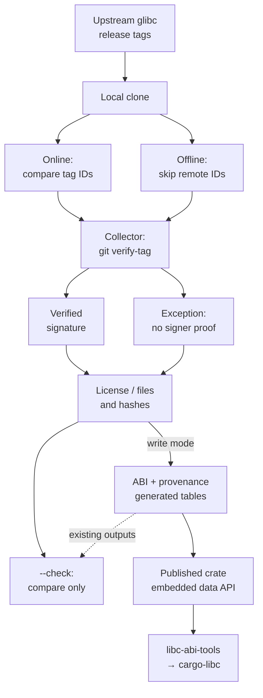

# Collecting and maintaining the dataset

This guide is for repository maintainers. Crate consumers only need the
[dependency setup](../README.md#getting-started). Read [AGENTS.md](../AGENTS.md)
before changing the repository. The collector is an unpublished MIT workspace
package; its binary is `glibc-abilists-collect`.

## Prerequisites and layout

Use Rust/Cargo 1.90 or later, Git, GPG, and Linux or WSL. GPG needs a temporary
directory whose permissions can be restricted; the collector creates a private
keyring containing only the checked-in public keys and removes it afterward.
Normal collection needs network access to sourceware and the configured
mirrors. No Rust crate dependencies need installing, and glibc is not built.

Run the commands below from the root of a checkout of this repository. Choose
an unused path for the upstream clone; `/tmp/glibc.git` is only an example.

| Path | Purpose |
| --- | --- |
| `upstream.toml` | Upstream/mirrors, inclusive release range, target, directory precedence, license file |
| `keys/` | Public keys, sources in `keys.tsv`, explicit reasons in `exceptions.tsv` |
| `data/<version>/<upstream path>` | Unmodified selected ABI files |
| `data/releases.tsv`, `data/files.tsv` | Release and file provenance |
| `src/generated.rs` | Generated tables embedding the data |
| `collector/src/main.rs` | Option parser, validation, collection, comparison, and writing |

## Collection flow and trust boundaries

This diagram shows accepted collection paths and delivery to consumers, not
runtime compatibility qualification. The recorded upstream tags are signed;
the collector requires annotated local tags, subject to the exception limits
below. Online and offline collection share the signature attempt and
license/file checks. Online compares upstream and available mirror tag objects;
offline skips that gate and requires a trusted local clone. Rejected signatures
and unlisted unverifiable tags stop collection.



The library exposes static data and lookups; `AbiList::verify()` checks hashes
only. An exception guarantees neither signature presence nor a match to the
configured key. Outputs are `data/` and `src/generated.rs`; repository outputs can be
regenerated, while an already published crate version is immutable. Exception
reasons are configuration, not attestations that fallback checks ran. In
particular, offline exception-tag output is not authenticated by its hashes or
license checks. See [Provenance](PROVENANCE.md#offline-collection-and-trust).

Traceability: [GA-REQ-006, GA-REQ-007, GA-REQ-008 and GA-REQ-009](REQUIREMENTS.md#requirements)
cover collection/check boundaries; [GA-REQ-001, GA-REQ-003, GA-REQ-005 and GA-REQ-011](REQUIREMENTS.md#requirements)
cover the selected data, library access, evidence and package boundary.

## Check without rewriting data

```sh
git clone --bare --filter=blob:none https://sourceware.org/git/glibc.git /tmp/glibc.git
cargo run --release --locked -p glibc-abilists-collector -- --glibc /tmp/glibc.git --check
```

The clone must have every configured release tag. A blobless clone fetches
contents as Git needs them. `--check` collects expected output, compares bytes,
and fails on missing, changed, or unexpected files within the selected release
directories. It leaves repository outputs untouched; Cargo may build the tool,
Git may fetch objects, and GPG uses temporary files.

## Options

Arguments after Cargo's `--` go to the collector:

| Option | Behavior |
| --- | --- |
| `--glibc REPO` | Required: local glibc clone, bare or non-bare |
| `--root DIR` | Repository containing configuration, keys, and outputs; defaults to the current directory |
| `--check` | Compare outputs; absence means rewrite |
| `--offline` | Skip upstream and mirror tag-object comparisons only |
| `-h`, `--help` | Print usage; the current implementation exits with failure even for help |

`--root` does not select Cargo's manifest. To launch from elsewhere, supply
both paths explicitly, replacing the example checkout path:

```sh
cargo run --manifest-path /path/to/glibc-abilists/Cargo.toml --release --locked -p glibc-abilists-collector -- --glibc /tmp/glibc.git --root /path/to/glibc-abilists --check
```

For disconnected operation, all needed Git objects must already be present.
A partial clone may still fetch blobs even with collector `--offline`. Cargo's
separate `--offline` flag controls Cargo, not Git subprocesses. With objects
and toolchain already available, the two flags can be combined:

```sh
cargo run --release --locked --offline -p glibc-abilists-collector -- --glibc /tmp/glibc.git --check --offline
```

This skips independent upstream/mirror comparison and is not a substitute for
the normal online release provenance gate. Signature verification is attempted
and license checks remain, but the documented signature exception still applies.

### Offline validation evidence

Offline write remains supported: `--offline` is independent of `--check`.
In particular, glibc 2.30 can pass via its exception without a verified signature
or remote tag-identity comparison. Use a trusted local clone; hashes and license
checks do not authenticate an untrusted replacement for that tag. The generated
provenance does not mark skipped remote checks, and the copied exception reason
must not be read as proof that mirror agreement was checked in that run.

Treat offline regeneration as provisional until the online `--check` shown
above passes against a trusted upstream clone for the candidate outputs. Retain
that validation result with the exact candidate commit. Rechecking offline
against freshly rewritten output is only a consistency check. An independently
trusted checkout is needed for an offline comparison to provide additional
evidence. See [offline collection and trust](PROVENANCE.md#offline-collection-and-trust)
for the scope of the existing CI mitigation and the planned follow-up.

## Rewrite deliberately

Review or save existing work first. Never hand-edit `data/` or
`src/generated.rs`. Omitting `--check` **overwrites generated outputs and deletes
unexpected files inside the configured release directories**. Directories for
versions outside the configured range are not cleaned. Writes are not atomic;
a filesystem error can leave partial output, so inspect failures before retrying.

```sh
cargo run --release --locked -p glibc-abilists-collector -- --glibc /tmp/glibc.git
cargo run --release --locked -p glibc-abilists-collector -- --glibc /tmp/glibc.git --check
git diff --stat
git diff --check
```

Collection stops on missing tags, upstream/mirror disagreements, unacceptable
signatures, or license evidence failures. Investigate the reported evidence;
do not bypass a failure by hand-editing generated files or inventing a signature
exception. See [PROVENANCE.md](PROVENANCE.md) for the existing glibc 2.30 exception.

For an approved release-range extension, first obtain the upstream tags and
review `upstream.toml`, key sources and license evidence. Regenerate, then update
range-specific tests, API documentation and scope statements to match. The
collector currently rejects targets other than `x86_64-linux-gnu`; changing the
configuration alone does not add architecture support. Follow the
[release plan](RELEASE-PLAN.md) for downstream qualification.

## Validate the change

For documentation only, check links/anchors, commands against the parser, the
rendered Markdown, and the diff. Run relevant doc tests if Rust examples change;
do not run unrelated builds for prose edits.

For code/data changes and release qualification, the repository checks are:

```sh
cargo fmt --all -- --check
cargo test --workspace --locked --offline
cargo clippy --workspace --all-targets --locked --offline -- -D warnings
RUSTDOCFLAGS="-D warnings" cargo doc --workspace --no-deps --locked --offline
```

Data changes additionally require the online collector `--check` above. Package
changes require `cargo package --locked` and inspection with
`cargo package --list --locked`. CI also tests Rust 1.90.0 and Windows/Linux;
consult the [workflow](../.github/workflows/ci.yml) for the current matrix.
Keep LGPL data/crate notices and MIT collector licensing distinct. Publishing
packages or creating releases requires explicit authorization; regeneration
and passing checks do not grant it.
